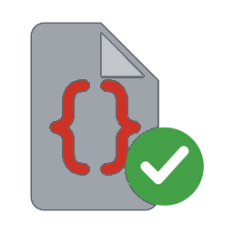

# Approved Scripts for Home Assistant

Approved Scripts lets an administrator approve a narrowly defined script revision for named non-admin Home Assistant users. Delegated execution uses an immutable, reviewed snapshot in system context; it never invokes the live script entity.

## Introduction

The integration currently supports two protected capabilities:

- `mqtt.publish`, with fixed topics and exact approved template results for a dynamic payload;
- `zwave_js.set_lock_usercode`, with one fixed lock target and code slot, and exact approved template results for a dynamic user code.

It is deliberately not a generic script sandbox or service whitelist.

## Quick start

Install using HACS, restart Home Assistant, add **Approved Scripts** from **Settings → Devices & services**, then refresh the browser once. Use the **Approved Scripts** admin page to review scripts and configure an approval.

- [Full documentation](https://as.lf.technology/)
- [Quick start](https://as.lf.technology/quick-start/)

## Contribution

See the [contributing guide](https://as.lf.technology/contributing/), especially the action-policy requirements for any new delegated capability.

## Licensing

Approved Scripts code is licensed under the [MIT License](./LICENSE.txt). Approved Scripts documentation prose and original documentation media are licensed under [CC BY 4.0](https://creativecommons.org/licenses/by/4.0/); documentation code and configuration examples remain MIT. See [the documentation license](./docs/LICENSE.md) for the full scope.
___
If you like Approved Scripts please make sure to ⭐️ the repository. Thank you.
