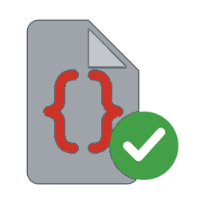

# Approved Scripts

## What is Approved Scripts?

Approved Scripts lets an administrator delegate carefully bounded admin-only script actions to named non-admin Home Assistant users.

Each approval is an immutable snapshot of the exact script revision reviewed. Templates may be used only when their rendered results match values explicitly approved by an administrator.

When a user runs an approved script, the integration validates the caller and every template result before executing that snapshot in system context. It never runs the live script entity.

## Start here

- [Quick Start](quick-start/index.md) explains installation, setup, and the approval workflow.
- [Using Approved Scripts](using/index.md) covers the management page, templates, repairs, and changed scripts.

## Security boundaries

This integration is intentionally not a generic service whitelist or a script sandbox. A Home Assistant non-admin action can be delegated only after it has a code-defined validator, a documented security boundary, and automated security tests.

- [Capability model](security/capability-model.md)
- [Capability threat matrix](security/capability-matrix.md)
- [Contributing](contributing.md)
